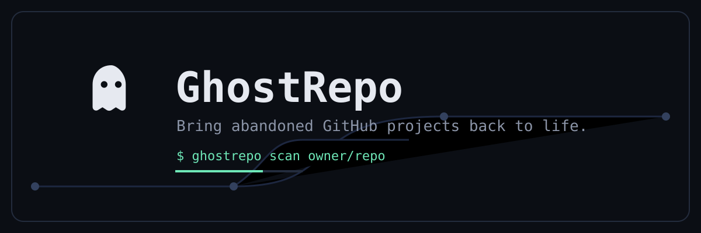
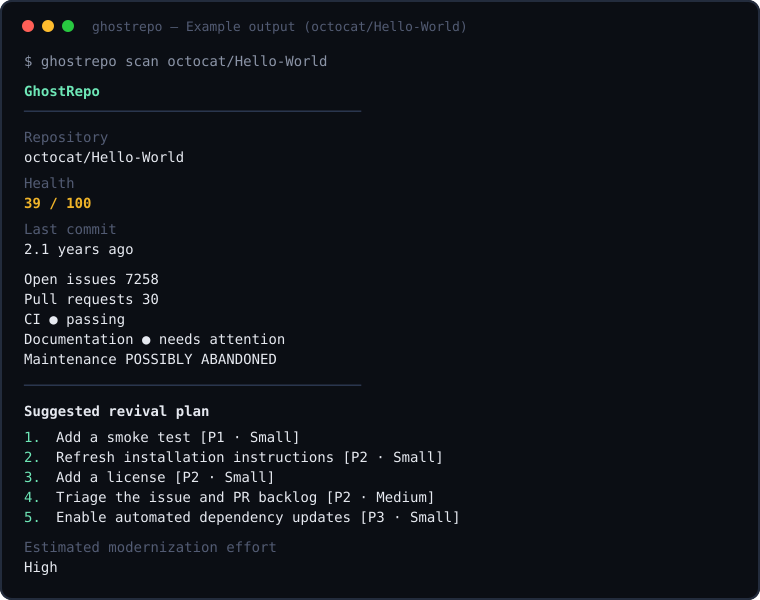

# GhostRepo



[](https://github.com/MOSTRE/ghostrepo/actions/workflows/ci.yml)
[](LICENSE)
[](package.json)

**Bring abandoned GitHub projects back to life.**

I kept finding old GitHub projects that were _almost_ useful.

The README would still be there. The issues would still be open. The code
would probably still work — except for three dependencies from 2021 and a
CI pipeline that hadn't passed in two years.

GhostRepo started as a small script to answer one question:

> **Is this repo actually dead, or does it just need some work?**

It scans a repository's public signals — last commit, issues, PRs, releases,
dependencies, CI, docs, tests — and gives you a straight answer with the
evidence attached. No hype, no "AI says 87%". Just the facts and a plan.

## What it does

- **Scan** any public repo: `ghostrepo scan owner/repo`
- **Score** it transparently — every point is documented (`docs/scoring.md`)
- **Detect** low maintenance activity with cautious, evidence-backed wording
- **Analyze** dependencies without guessing (unknown means unknown)
- **Plan** a prioritized revival: security first, then build, then docs
- **Export** JSON / Markdown / HTML reports
- **Browse** results in a small Next.js dashboard
- **Automate** with a weekly GitHub Action

What it doesn't do (yet, on purpose): push code, open PRs, or rewrite your
dependencies. `modernize` writes a plan for you to review first.

## Example output

Real output from `ghostrepo scan octocat/Hello-World` (public demo repo,
used here as an example — your results will differ per repository):



```text
GhostRepo
────────────────────────────────────────

Repository
  octocat/Hello-World — My first repository on GitHub!

Health
  39 / 100

Last commit
  2.1 years ago (2024-08-20)

  Stars              3835
  Forks              6942
  Open issues        7258
  Pull requests      30
  Dependencies       none parsed
  CI                 ● passing — Latest workflow run passing
  Documentation      ● README present (13 chars), LICENSE missing
  Tests              not detected
  Maintenance        POSSIBLY ABANDONED

────────────────────────────────────────

Suggested revival plan

  1. Add a smoke test [P1 · Small]
  2. Refresh installation instructions [P2 · Small]
  3. Add a license [P2 · Small]
  4. Triage the issue and PR backlog [P2 · Medium]
  5. Enable automated dependency updates [P3 · Small]

Estimated modernization effort
  High
────────────────────────────────────────
```

And the score breakdown (`ghostrepo score`):

```text
Ghost Score: 39/100

Maintenance       0/25    last push 25.3 months ago
Recent activity   6/20    3 commits in latest-30 sample, 3 contributors
Dependencies     15/15    no manifest dependencies found
CI health        15/15    recent workflow runs passing
Documentation     2/10    README present, LICENSE missing
Tests             0/5     no tests detected
Issues/PRs        0/5     7258 open issues, 30 open PRs
Releases          0/5     no releases published
```

## Installation

Requires Node 20+.

```bash
git clone https://github.com/MOSTRE/ghostrepo.git
cd ghostrepo
npm install
npm run build:packages
```

To use the CLI anywhere:

```bash
cd cli && npm link
# now `ghostrepo scan owner/repo` works globally
# or without linking: node cli/dist/index.js scan owner/repo
```

GitHub API limits unauthenticated requests to 60/hour. For real use, set a
token (see `.env.example`):

```bash
cp .env.example .env
# add GHOSTREPO_GITHUB_TOKEN=ghp_...
```

Or just use the `gh` CLI — GhostRepo picks up `GITHUB_TOKEN` automatically.

## Quick start

```bash
ghostrepo scan owner/repo                 # full health scan
ghostrepo scan https://github.com/owner/repo
ghostrepo score owner/repo                # transparent score breakdown
ghostrepo deps owner/repo                 # dependency health table
ghostrepo activity owner/repo             # activity + abandonment evidence
ghostrepo plan owner/repo                 # prioritized revival plan
ghostrepo report owner/repo --markdown --html   # write report files
ghostrepo modernize owner/repo            # write .plan/modernization.md for review
ghostrepo modernize owner/repo --apply    # safe local files on a new branch, no push
ghostrepo auth login                      # check GitHub auth
```

## Dashboard

A small Next.js UI — search box on the home page, health/activity/deps/plan
cards on the repo page, dark mode included.

```bash
npm run dev:dashboard
# open http://localhost:3000
```

## How it works

```text
CLI → Core → GitHub Provider → Repository Analyzer → Scoring Engine → Report Generator
                                                                    ↘ Dashboard / GitHub Action
```

Details: [`docs/architecture.md`](docs/architecture.md).

## Scoring

Weighted sum, 0–100, defaults sum to 100:

| Category        | Weight |
| --------------- | ------ |
| Maintenance     | 25     |
| Recent activity | 20     |
| Dependencies    | 15     |
| CI health       | 15     |
| Documentation   | 10     |
| Tests           | 5      |
| Issues/PRs      | 5      |
| Releases        | 5      |

Missing data scores 0 for that slice and shows up as `unavailable` — a repo
is never called healthy because a check failed quietly. Weights are
configurable via `GHOSTREPO_WEIGHT_*`. Full formula: [`docs/scoring.md`](docs/scoring.md).

## On "abandoned"

GhostRepo never says a project is dead. It says things like:

- _Possibly abandoned_ (with the evidence listed underneath)
- _Low recent maintenance activity_
- _Appears inactive based on available repository signals_

An archived repo, 25 months without a push, 7,000 open issues — that's not a
verdict, it's an observation. You decide what to revive.

## Security

Scanned repositories are treated as untrusted input: manifests are parsed,
never executed; report paths can't escape the working directory;
subprocesses are argv-based with an allowlist (`git`, `gh`); tokens never
appear in output or reports. Full model: [`docs/security.md`](docs/security.md).

## GitHub Action

`.github/workflows/ghostrepo.yml` runs a weekly scan and uploads
`ghostrepo-report.json` / `.md` / `.html` as artifacts. Copy it into your
repo — it only needs Node and the automatic `GITHUB_TOKEN`.

## Roadmap

Short version: more parsers, commit history charts, stale-branch listing,
npm publish. Long version: [`docs/roadmap.md`](docs/roadmap.md).

## Contributing

See [`CONTRIBUTING.md`](CONTRIBUTING.md). Tests run offline, the core stays
LLM-free, and half-formed ideas are welcome as issues.

## Development

```bash
npm test              # 26 tests, no network
npm run typecheck
npm run lint
npm run format
npm run build         # packages + CLI + dashboard
```

More: [`docs/development.md`](docs/development.md), [`docs/cli.md`](docs/cli.md).

## License

MIT — see [LICENSE](LICENSE).
